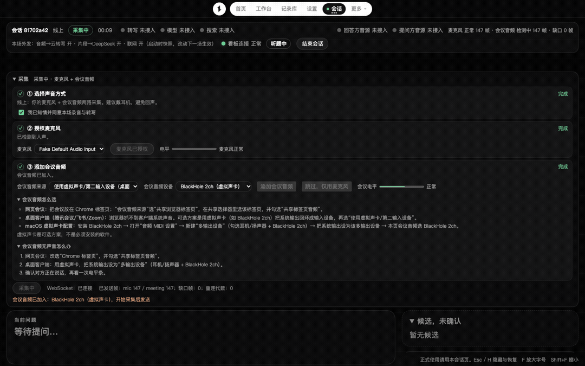

# 访谈提示板 / Interview Prompt Board

[](https://github.com/lbh-banboo/interview-prompt-board/actions/workflows/ci.yml)
[](LICENSE)
[](requirements.txt)
[](package.json)

**EN**: A local-only interview teleprompter — it transcribes the interviewer's questions in real time, retrieves matching talking points from a Q&A bank you personally reviewed, and shows them on a prompt board. All data stays on your machine.

面试实时提词系统：把对方的提问实时转写出来，从你自己审核过的题库里找出对应的回答要点，显示在提示板上。
服务只在本机运行（`127.0.0.1:8765`），数据存在本机 `data/` 目录。



> 状态：个人项目，只在 macOS（Apple Silicon）上开发和测试过。真机场景（扬声器回声、各会议客户端、30 分钟以上连续采集）尚未系统验证，单价与阈值也是估算值。演示动图为本地验证模式（未接入云端模型）。

## 先读这一节：默认会把什么发到哪里

默认配置下，下面三项外发**都是开启的**，可在设置页或每场会话开始前关闭。

| 外发项 | 发给谁 | 内容 | 对应开关 |
|---|---|---|---|
| 音频 → 云转写 | 阿里云实时语音识别（需要 `DASHSCOPE_API_KEY`） | 会议/房间音频；**单麦或线下模式下混音只有一路，会包含你自己的声音** | `outbound.asr_audio` |
| 片段 → DeepSeek | DeepSeek（需要 `DEEPSEEK_API_KEY`） | 识别出的问题和题库片段；题库增强功能还会发送题库条目（手机号、邮箱、证件号、银行卡号会先遮盖） | `outbound.llm_snippets` |
| 问题 → 联网搜索 | DeepSeek Search | 脱敏后的知识类问题；个人经历类问题不会联网 | `outbound.web_questions` |

- 没有配置对应的 Key，或关闭开关，就不会外发；音频转写会回退到本机的 sherpa-onnx 模型。
- 本场会话开始后只能关闭外发项，不能再打开全局已关闭的项。
- **录音前请取得所有参与者的知情同意**，并确认你所在地区和所在公司对录音、使用第三方云服务的规定。
- 日志、导出和凭证面板不会输出明文 Key。Key 的读取顺序：环境变量，macOS 钥匙串，`data/.env`。

## 安装

需要 Python 3.13 和 Node.js 22（均为开发时使用的版本）。

```bash
git clone git@github.com:lbh-banboo/interview-prompt-board.git
cd interview-prompt-board
python3 -m venv .venv
.venv/bin/pip install -r requirements.txt
npm install
npm run build                                  # TypeScript 编译到 web/
.venv/bin/python tools/fetch_models.py         # 下载并校验本地模型，约 360 MB
```

模型权重不随仓库发布，`tools/fetch_models.py` 按 `models/MANIFEST.json` 的 sha256 下载并校验。
访问不了 huggingface.co 时设置镜像：`HF_ENDPOINT=https://hf-mirror.com`。只想校验本地文件加 `--check`。

## 运行

```bash
.venv/bin/python run.py
```

浏览器打开 `http://127.0.0.1:8765`。服务只监听回环地址，**没有账号体系**：
页面用每次启动随机生成的 `X-Local-Token` 防跨站请求，这不是登录认证，请不要把端口转发或暴露到其他机器。

Key 可以在工作台“凭证”面板填写，也可以用环境变量：

```bash
export DASHSCOPE_API_KEY=...   # 阿里云实时转写
export DEEPSEEK_API_KEY=...    # 提示生成、题库增强、联网搜索
export SEARCH_API_KEY=...      # 可选；不填则搜索复用 DEEPSEEK_API_KEY
```

`model.base_url` 和 `search.endpoint` 会带着 Key 发请求，只接受 https 地址（本机回环地址可用 http）。

## 测试

```bash
.venv/bin/python -m pytest -q   # 后端
npm test                        # 前端：编译 + 单元测试 + Playwright e2e（实测约 1 分钟，视机器而定）
```

e2e 需要 Chromium：`npx playwright install chromium`。
部分后端测试依赖本地模型，缺失时会自动跳过。

## 目录

- `app/` 后端（FastAPI）：音频接入、转写、轮次判定、检索、提示生成、预算、记录与导出
- `web/` 前端（TypeScript 源码与编译产物），`web/landing/` 欢迎首页
- `tests/` 后端测试，`tests_web/` 前端测试
- `tools/` 评测、标定和模型下载脚本，`eval/` 合成数据评测与报告
- `seeds/` 通用建议库种子，`models/MANIFEST.json` 模型清单
- `docs/` 面向使用者的文档：`项目详细说明.md`（功能、流程、架构、限制）、`模块工作原理.md`（每个模块的内部机制）、接口契约、会议客户端兼容矩阵、开源前检查清单

## 功能模块地图

每个模块的内部机制（参数、协议、状态机）详见 [`docs/模块工作原理.md`](docs/模块工作原理.md)。

| 模块 | 代码 | 职责 |
|---|---|---|
| 音频接入 | `app/audio/` | 20ms 二进制帧协议、WAV 落盘补洞、Silero VAD 分段、声纹登记、回声检测 |
| 流式转写 | `app/asr/` | 本地 sherpa / 阿里云双后端统一适配、热词下发、用量计量、断线退避与降级 |
| 轮次判定 | `app/domain/` | 两阶段状态机（候选→提交→可回滚）、语义完整度、打断分类、声纹判角色 |
| 检索路由 | `app/retrieval/` | 意图分类、FTS5 trigram + 向量 RRF 融合、三证据命中判定、L1/L2/L3 三级路由 |
| 题库 | `app/library/` | Markdown 拆条、版本化重导入继承审核状态、LLM 增强与事实比对、冲突检测 |
| 会话编排 | `app/realtime/` | 帧→VAD→ASR→判定管线、AnswerLoop 提示闭环、事件总线、防串题双闸 |
| 会前准备 | `app/sessions/` | 会话生命周期、并发自检、回答者资料、探测原则 |
| 隐私 | `app/privacy/` | 外发前 PII 脱敏与个人经历题整题拦截 |
| 记录导出 | `app/records/` | 独立记录库、白名单导出、实际发言与系统建议分离、删除两步制 |
| 状态板 | `app/health/` | 8 能力三态（ok/degraded/down）与降级矩阵 |
| 埋点评测 | `app/telemetry/` | 延迟埋点、时钟偏移估计、WAV 回放、评测报告（合成链路永不判 PASS） |
| 支撑 | `app/credentials.py` 等 | 凭证读取顺序、预算 reserve/settle、配置 schema 校验与会话快照 |
| 前端 | `web/` | AudioWorklet 采集、断线重放、提示板纯函数 reducer、快捷键（无框架，tsc 直编） |

## 许可证

本仓库自己的代码按 MIT 发布，见 `LICENSE`。
第三方代码、模型和素材各自适用原许可证，见 `THIRD_PARTY_NOTICES.md`。
**欢迎首页的视频、海报、logo 和三款字体来源未核实，不在 MIT 范围内**（维护者决定按现状发布，收到权利人异议即替换），详情见该文件。
