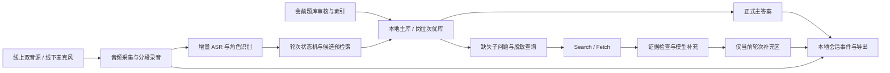

# 面试实时提词系统——技术可行性与方案对比

日期：2026-10-26｜阶段：技术查证与方案建议，未开始业务实现

## 1. 结论摘要

建议采用 V2 的分层设计与 V3 的轻量本地部署方式：HTML/CSS/TypeScript 前端 + Python FastAPI 本地服务 + SQLite/本地文件 + 可替换的语音、说话人识别、DeepSeek 与搜索适配器。

这只是建议，尚未替用户拍板技术方案，尚未开通或购买任何服务。

四个结论：
1. 用户指定的 DeepSeek Flash 4.1 已能在当前官方文档中确认，推荐调用名是 deepseek-flash，对应 DeepSeek-V4.1-Flash-1017。[1]
2. DeepSeek 原生提供 Search/Fetch，复用同一 Bearer Key；搜索仍是独立 HTTP 调用，不等于聊天接口自动联网，也不覆盖实时 ASR 与声纹识别。[2]
3. 本地命中首次提示应直接展示会前准备的已审核提纲，不等待模型现场重写。模型作为补充润色支路，才能避免把 0.5 秒快速路径绑在外部网络上。
4. 最大风险是 0.3 秒问题结束判断和线下单麦克风角色识别。1.5 秒联网有效要点同样没有文档中的延迟保证；必须实际测试，不能承诺。

## 2. 核实的模型与搜索接口

### 2.1 DeepSeek Flash

官方当前明确推荐 model=deepseek-flash，模型版本 DeepSeek-V4.1-Flash-1017；OpenAI 兼容 base URL 为 https://api.deepseek.com，聊天端点为 /chat/completions。[1]

支持流式输出；实时答案建议使用 stream=true，并在 OpenAI 格式中显式设置 thinking.type=disabled。默认是开启思考且强度 high，不显式关闭会引入非必要等待。[3]

模型承担：准备期 Markdown 理解、问答拆解与提示提纲生成；现场增量语义辅助、答案改写、来源约束下的知识补充。不要把每个音频帧、每次端点判断全部串行交给大模型。

所查首页、价格及思考文档没有证明它提供本系统所需实时 ASR 或声纹登记能力，不能据此认为一个聊天接口能完成语音链路；也不能根据页面未提及就断言平台绝不具备其他音频能力。

### 2.2 Search 与 Fetch

官方接口：[2]
- Search：POST https://api.deepseek.com/v1/tools/search。
- Fetch：POST https://api.deepseek.com/v1/tools/fetch。
- 两者复用 DeepSeek API Key 的 Bearer 鉴权。
- Search 返回 title、url、snippet、summary、date、authority、rerank_score 等结构。
- need_content=false 不在响应中获取正文，适合先测试轻量搜索路径；减少流程步骤不代表已证明延迟降低。
- Fetch 单独抓取 Markdown 正文，受目标站点可用性影响。

建议快速路径：脱敏查询 → Search → 检查相关性和证据充分性 → 展示可支持结论的短要点及链接；完整正文与模型整理在后续补充。不可只展示链接或空泛摘要就计为“可用答案”。

1.5 秒是用户目标，官方所查文档未提供该延迟 SLA。搜索 API 响应为原始 JSON，并非边搜索边逐条流出；所谓“逐条补充”应由应用在结果返回、来源处理和后续生成时组织。不要在前端制造逐字动画冒充更快的后台结果。

### 2.3 已核查价格

官方价格页截至查证日：[4]

| 项目 | 空闲时段 | 高峰时段 |
|---|---|---|
| Flash 输入缓存命中，百万 token | ¥0.02 | ¥0.04 |
| Flash 输入未命中，百万 token | ¥1 | ¥2 |
| Flash 输出，百万 token | ¥4 | ¥8 |
| Search，每千次成功请求 | ¥5 | ¥5 |
| Fetch，每千次成功请求 | ¥5 | ¥5 |

高峰规则按官方页面：北京时间工作日（不含中国法定节假日）9–12 点、14–18 点；其他时段空闲。价格会变化，接入前重新核查。

Search/Fetch 只有成功且产生结果的请求计费；不要把 Harness/Claude Code/Codex 特定服务端工具的临时免费规则理解成自建脚本直接调用也免费。

预算估算方法：
总费用 = 缓存命中 token × 对应费率 + 非命中 token × 对应费率 + 输出 token × 对应费率 + Search 成功次数 × ¥0.005 + Fetch 成功次数 × ¥0.005 + 语音识别费用。

例如每场 20 次成功 Search 与 5 次成功 Fetch，搜索抓取部分为 ¥0.125；这是次数假设，不是每场总价。双路音频的语音服务可能按两路分别计费，不能只按会话墙钟时长估算。语音供应商尚未选定，不能给出可靠总价。

## 3. 浏览器收音与本地部署

### 3.1 可依赖与不可依赖的边界

推荐 localhost 页面，不把本地实现约束为 file://。浏览器承担明确的用户授权与音源展示；后端代理服务端密钥，不向前端发送长期 Key。

Chrome 141 官方发行说明包含 windowAudio 与 restrictOwnAudio：[5]
- windowAudio 是选择窗口时如何提供音频分享选项的提示，可选 exclude、system、window。
- restrictOwnAudio 只有原始捕获本来包含系统音频时才有作用，不能凭空生成音轨。
- API 选项存在不代表所有 macOS 和桌面会议组合必然捕获成功。

getDisplayMedia 必须在用户触发及授权下选择共享表面；请求音频不能保证返回音轨。按目标设备检查返回轨道、能量、远端是否可听、是否包含自身回声，而不是只看权限成功。[6]

### 3.2 采集验证矩阵

| 场景 | 要验证的事实 |
|---|---|
| 浏览器标签页会议 + 耳机 | 远端音频是否独立捕获、麦克风是否独立、是否重复回答者声音 |
| 桌面会议软件 + 耳机 | 当前 macOS/浏览器能否获取目标窗口/系统音轨 |
| 扬声器播放 | 回声、双路重复和错误角色归属 |
| 线下单麦克风 | 多人距离、噪声、声音登记、插话和重叠 |
| 切换或中断音源 | 事件反馈、持续录音、轨道恢复和数据隔离 |

如果桌面会议音频浏览器采集失败：提供原因与方案，可能需要本地音频辅助脚本、系统原生捕获或虚拟音频路由。额外组件先确认，不自动安装驱动，不静默把线上双音源降为外放单麦克风。

## 4. 语音、角色与轮次方案

### 4.1 候选 ASR

阿里云官方实时识别文档明确提供中文、混合语言的流式方案；Fun-ASR/Paraformer 与 Qwen 实时系列可作为候选。[7] 文档区分实时和录音文件转写，不得把文件转写的说话人分离当实时能力。

部分服务端 VAD 默认静音达 800ms，推荐对话场景 400ms，这本身就超出 300ms 总预算；需核查具体候选的端点控制、增量文本回传频率、手动提交与最终文本等待机制。各系列参数不同，不混用。

建议先试验两类路线：
- 云 ASR 持续增量回传 + 本地 VAD/角色/语义候选，避免等待云端最终句再启动检索。
- 本地流式 ASR + 本地 VAD 和声音嵌入，在目标电脑上测试计算负载与中文术语准确性。

浏览器内置语音识别可用于探索，不作为生产验收默认依赖：稳定性、连续运行和说话人能力需验证，不能把其后台服务当完全本地。

### 4.2 额外核查的语音与本地候选

Deepgram 官方区分中文 ASR 和语义轮次模型：Nova-3 当前支持中文；Flux 官方语言列表未列中文，不能用 Flux 的原生 EndOfTurn 作为普通话场景的现成保证。[8][9]

Deepgram endpointing=300 表示等待 300ms 静音才结束相应区间并返回 speech_final；这仍不是语义完整问题判断。所查示例的 UtteranceEnd 配置为1000ms，不作为本系统300ms能力证据。[10]

实时 diarization 返回 speaker；speaker_confidence 仅预录场景提供。它不是本项目声音登记身份验证的直接证明；两路音源的标签必须带来源标识，不应仅用speaker编号跨流关联。[11]

本地候选 sherpa-onnx 官方目录提供流式 ASR、VAD、SpeakerEmbeddingExtractor/Manager 和说话人识别入口，并有 macOS 安装说明；具体芯片架构、模型组合、准确率、登记时长和300ms性能仍需验证。[12]

macOS 系统音频的原生兜底可进一步评估 Apple Core Audio taps。当前官方页面正文未能有效读取，其版本、权限及按应用捕获细节未核实，不作为已确认方案。涉及辅助组件时先确认，不自动安装。

快速、可撤回的 speech_end_candidate 必须和已确认的 turn_end_committed 分开；不能用候选事件完成时间冒充用户要求的正式结束判断。检测插话不应一律取消当前答案，只在确定改题等状态迁移时废弃旧轮次输出。

### 4.3 身份识别不是说话人分离

Diarization 回答“这段音频由哪个匿名说话人说”，speaker verification/identification 才涉及“是否是登记的回答者”。用户选择声音登记，不代表所选 ASR 自带登记比对功能。

线下需验证声音参考和短语音片段比对，使用拒识阈值，不能把非匹配或极短片段都确定归为面试官。角色置信度不足时显示不确定；同时记录拒识率，防止全部拒识获得虚假的准确率。

声音变化、远场、回声、重叠说话会影响两类识别。重叠发生时先报告插话，但未能可靠分离不意味着可以立即准确识别新题。

### 4.4 300ms 问题结束预算

端到端延迟包含：音频缓冲 + 发言结束检测 + ASR 文本滞后 + 角色/语义判定 + 传输及调度。某些部分可并行，但总预算仍须实测。

因此：
- endpointing=300ms 不等于总延迟≤300ms，单纯等待静音已吃完预算。
- 本地 VAD 可减少网络等待，但不能仅凭静音判定语义结束。
- 预检索可缩短“判定后显示”延迟，不能证明“实际说完到判定”缩短。
- 如需额外等待确认完整问题，必须记录超时，不重置时间。

当前没有可信证据证明这个系统可以同时达到 P95 300ms 和过早结束率≤2%；作为红色风险先验证。

## 5. 建议架构

### 5.1 技术栈建议

| 层 | 推荐 | 理由 |
|---|---|---|
| 前端 | 原生 HTML/CSS + TypeScript，轻量构建 | 满足本地 HTML 形式，避免重型前端依赖 |
| 音频 | MediaDevices、Web Audio/AudioWorklet、独立录音轨 | 将实时 PCM 与保存录音区分，支持两路状态 |
| 本地服务 | Python FastAPI + HTTP/WebSocket | 便于语音与模型生态接入，实时事件统一 |
| 数据 | SQLite + 本地录音文件 | 单机单场足够，避免引入独立数据库服务 |
| 检索 | 会前索引、中文词项/别名、可选本地向量 | 先快速路径，向量模型性能和授权另验 |
| 模型 | DeepSeek Flash 适配器 | 名称与配置可调整，非思考流式输出 |
| 搜索 | 优先验证 DeepSeek Search/Fetch | 同 Key 减少供应商，仍可替换 |
| 语音与声纹 | 可替换适配器，待实测选定 | 不预设单服务覆盖全功能 |
| 事件隔离 | session/turn/revision 标识与取消机制 | 从前后端同时防止迟到串题 |

SQLite 是候选方案而非用户指定选型，备份导出和文件写入完整性需测试。完整前端框架、独立向量数据库和云后端不是首版必需。

### 5.2 快慢路径

准备期：文档理解 → 用户审核 → 问答/事实关联 → 提纲生成 → 索引及热点缓存。

现场快路径：增量转写 → 预匹配 → 问题完成 → 已审核提纲直接渲染。库外可显示标准兜底状态，但不能计为答案。

现场慢路径：未覆盖子问题 → 岗位建议 → 脱敏搜索 → 来源要点 → 模型组织补充。主答案不被覆盖；每次输出校验本题是否仍活跃。

## 6. 四套方案对比

| 方案 | 结构与定位 | 优点 | 缺点 | 适合场景 | 风险 |
|---|---|---|---|---|---|
| V1 最快验证版 | 单脚本服务 + 原生 HTML + 简单本地索引 + 外部 ASR | 验证真实音源与快速提示最直接，依赖少 | 结构与审核管理简化，完整首版范围不能一次覆盖 | 首个技术可交付切片 | 只验证部分能力，不能包装为全系统达标 |
| V2 稳定可扩展版 | FastAPI 分层 + TS 前端 + SQLite + 独立适配器/状态机/测试 | 数据隔离清晰，岗位与供应商可扩展，易追踪问题 | 初始接口、事件模型和测试投入更多 | 本项目长期维护 | 全自动声纹和300ms仍要实测，不因分层自动解决 |
| V3 个人开发版 | 精简本地单进程 + HTML + 文件/SQLite + 轻量插件接口 | 安装运行简单，单人维护效率高 | 插件边界容易退化，复杂任务抢占需控制 | 单机个人持续使用 | 本地模型计算会争抢ASR/录音资源 |
| V4 完整生产版 | 桌面采集辅助 + 本地与可选后端 + 全面监控/CI/自动测试 | 音源控制与运维能力强，利于跨平台长期扩展 | 开发、签名、权限与服务成本最高 | 验证成功后产品化 | 扩大数据合规与运维面，超出首期多账号和并发范围需再次确认 |

V1 是验证切片，不是静默削减需求；V4 的远程、多账号能力仅是后续方向，不纳入已冻结首期。没有根据给出“几天完成”的交付承诺。

推荐 V2 为正式结构，采用 V3 的本地轻部署；先以 V1 的实验范围验证红色风险。正式选型须用户确认。

## 7. 风险清单：根因与应对

| 等级 | 风险/根因 | 应对与放行条件 |
|---|---|---|
| 高 | 300ms端点预算包含多种等待，ASR最终结果可能更慢 | 实际标注音频测量，增量文本/本地判断并行；未达标如实FAIL |
| 高 | 线下短片段声音识别不稳定，分离不是身份认证 | 登记比对独立试验，测拒识和重叠，不提供虚假保证 |
| 高 | 桌面会议音轨受平台与权限限制 | 真实目标矩阵；辅助采集需另确认 |
| 高 | 搜索 + 证据检查 + 组织要点可能超1.5秒 | 先合格摘要，非必需全文异步；逐次统计，8秒取消/降级 |
| 高 | 模型生成改变个人事实 | 事实引用与输出验证；人工参考测试，出现一次FAIL |
| 高 | 异步ASR/搜索输出在切题后返回 | session/turn/revision校验、取消与原题归档，前后端双保险 |
| 中 | 主库语义相似但个人项目不同 | 资料隔离、审核版本、子问题覆盖与拒绝匹配 |
| 中 | 长录音浏览器内存/关闭丢失 | 独立分段落盘、保存确认、磁盘报警、恢复测试 |
| 中 | 网页与Markdown恶意脚本/提示注入 | 转义渲染、来源不执行、路径约束、密钥不入前端 |
| 中 | 双路语音费用、重试重复请求 | 计量每音源，限制重试，超额降级；接入前预算确认 |

## 8. 下一步实施计划与门禁

### 阶段 A：冻结方案与外部服务许可

确认正式技术栈、首个验证切片、语音候选服务及其费用/留存。用户提供Markdown样例和凭证时再做真实API测试；不在交付文档里存放Key。

### 阶段 B：定义数据与事件

先定义资料/库版本/会话/音源/转写/轮次/提示/证据对象，以及中断、拒识、取消、迟到归档的状态机。明确事件时钟与统计分母，防止虚假达标。

### 阶段 C：真实高风险试验

1. 浏览器线上双源实际录到正确声音，线下登记/角色识别试验。
2. 连续转写与结束判定测量，普通问题与长停顿分别统计。
3. 已审核本地提纲首次渲染≤500ms验证。
4. 脱敏Search首条可用要点≤1500ms与8秒超时验证。

不需要先做完整漂亮UI。没有服务Key时只能完成模拟协议与本地部分测试，不能给真实语音/搜索PASS。

### 阶段 D：完整首版实现

资料和题库审核 → 索引 → 语音/状态机 → 分级检索 → 稳定提示与补充 → 记录导出 → 故障与隐私控制。每模块完成后审查安全、正确性、性能、维护性和测试；CRITICAL/MAJOR修复后继续。

### 阶段 E：正式验收与简化

固定线上/线下真实测试集，输出PASS/FAIL/NOT TESTED和有效样本数。复杂场景单独列，不以平均值代替P95。不使用无来源缓存假装实时搜索成功，也不凭小样本证明95%泛化。测试通过后简化去重并回归。

## 9. 本阶段校验结果

| 检查项 | 状态 | 说明 |
|---|---|---|
| 完整需求基线 | PASS | 已整理确认范围、边界与验收 |
| DeepSeek模型名称及流式/模式配置文档 | PASS | 官方文档查证 |
| DeepSeek Search/Fetch与价格文档 | PASS | 官方文档查证 |
| 浏览器音频选项文档 | PASS | 查证支持选项不代表现场采集达标 |
| 四方案及取舍 | PASS | 已提供，不代表用户已选定 |
| 真实麦克风/会议音频采集 | NOT TESTED | 未授权实测 |
| ASR/声纹/300ms正确性性能 | NOT TESTED | 未选型及真实验证 |
| Search/模型1.5秒实际性能 | NOT TESTED | 无用户Key，未压测 |
| 完整系统业务实现 | NOT STARTED | 本轮止于说明与下一步方案 |

文档查证/方案检查：5项PASS；真实技术验证：3项NOT TESTED；业务实现：1项NOT STARTED。不得把文档PASS计入系统性能验收。

## 10. 官方来源

[1] DeepSeek 首次调用 API：https://api-docs.deepseek.com/zh-cn/

[2] DeepSeek 网页搜索与抓取：https://api-docs.deepseek.com/zh-cn/guides/search/

[3] DeepSeek 思考模式：https://api-docs.deepseek.com/zh-cn/guides/thinking_mode

[4] DeepSeek 模型与价格：https://api-docs.deepseek.com/zh-cn/quick_start/pricing

[5] Chrome 141 发行说明：https://developer.chrome.com/release-notes/141?hl=zh-cn

[6] MDN getDisplayMedia：https://developer.mozilla.org/en-US/docs/Web/API/MediaDevices/getDisplayMedia

[7] 阿里云实时语音识别：https://help.aliyun.com/zh/model-studio/real-time-speech-recognition

[8] Deepgram 模型与语言：https://developers.deepgram.com/docs/models-languages-overview

[9] Deepgram Flux 语言：https://developers.deepgram.com/docs/flux/language-prompting

[10] Deepgram Endpointing：https://developers.deepgram.com/docs/endpointing

[11] Deepgram Diarization：https://developers.deepgram.com/docs/diarization

[12] sherpa-onnx 官方文档：https://k2-fsa.github.io/sherpa/onnx/index.html

所有动态价格、模型名和平台兼容性应在正式接入前再次核查。
